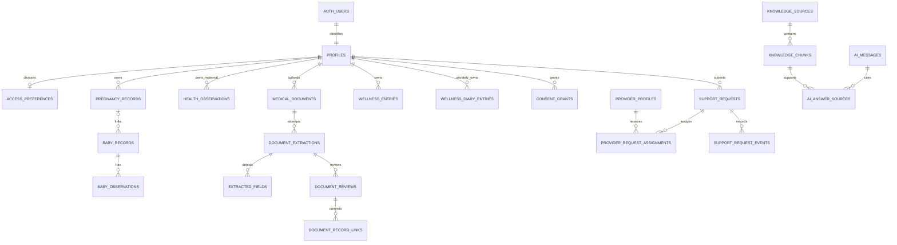

# PROHOR — Step 7 data model

Status: **proposed architecture for owner review**, prepared 16 November 2026 (Asia/Dhaka). Lead: Omor. Supabase PostgreSQL is the target. This document defines the logical model for all eight modules; it does not create tables, apply migrations, approve clinical content, or establish team agreement.

Read with [API contracts](api-contracts.md), [security requirements](security.md), [team review](team-contracts.md), and the [shared contracts](../../src/lib/contracts/index.ts).

## Repository baseline and implementation boundary

| Item | Observed state | Consequence |
| --- | --- | --- |
| `supabase/migrations/001_initial.sql` | Illustrative SQL with 11 tables and owner-oriented RLS; deployment not verified | Preserve it as history; do not treat its existence as a deployed backend |
| `src/lib/access-preferences.ts` | Local v1 settings, independently combinable; no account sync | Reuse names/defaults; propose a versioned persistence contract |
| `/api/ai/chat` | Input validation then 501 `not_connected` | No working retrieval or medical answers |
| `/api/health` | GET only; 503 without config, 401 without a user, otherwise 501 | No working record persistence |
| `/api/care-requests` | Input validation then 501 `not_sent`; auth/delivery TODO | No working provider delivery |
| Shared contracts added in Step 7 | Strict Zod schemas and inferred TypeScript DTOs | Working validation utilities; planned API/storage behavior remains prototype/future |

No new SQL, generated Supabase `Database` type, private storage bucket, auth role, provider approval, source content, or medical fixture is deployed in this step. Day 2 must translate the approved subset into forward migrations plus policy tests. The screenshot's eight module names map to these domains; no UI change is required for this architecture step.

## One connected journey

Public Barta education, Shonket reviewed guidance and Poth listings do not require a pregnancy profile. Authentication is required when a mother saves personal records. Adapt applies independently throughout. A mother can save a self-reported maternal observation, keep baby observations in a separate record, optionally verify a supported synthetic report, then explicitly share selected record fields with an approved simulated provider. The provider sees an assigned request and consented projections. Private diary and AI conversations stay outside that projection.

The diagram shows key relationships; the following catalog is authoritative for the full proposal. No generic “all health data” table or duplicated Shonket/Bondhon request store is proposed.

## Naming, keys and common fields

- SQL uses `snake_case`; JSON/TypeScript uses `camelCase`. A server mapper performs explicit column projection. These DTOs are not database rows.
- Unless stated otherwise, each entity has `id uuid PK`, `created_at timestamptz`, `updated_at timestamptz`, and `revision integer > 0`. Dates without a time use `date`. Timestamps represent instants; clients display them in the user's locale/time zone.
- Every personal entity carries `owner_user_id uuid NOT NULL FK profiles(user_id)`, even if ownership can also be reached through a parent. `profiles.user_id` is the Auth user UUID PK/FK. Personal DTOs in this demo require `data_mode = 'synthetic'`; real patient-data collection is outside this release.
- Parent tables expose `UNIQUE(id, owner_user_id)`. Child references use composite FKs such as `(pregnancy_id, owner_user_id)` and `(baby_id, owner_user_id)`. Validate these on insert and update, including worker writes. Client-supplied UUIDs are never proof of ownership.
- Maternal observations live in `health_observations`; baby observations live in `baby_observations`. A maternal pregnancy link may be null for records outside a pregnancy. Baby observations always reference a baby. A baby can have a nullable pregnancy link, supporting newborns without a recorded pregnancy and multiple babies per pregnancy.
- Use precise `numeric` for measurements. Wire values are decimal strings with explicit supported units; never silently convert, round, infer, or manufacture observations from gestational week. Original extracted strings remain immutable.
- Use `text` with CHECK constraints for small status vocabularies, allowing reviewed forward changes. Use JSONB only for bounded, versioned settings or immutable extraction/review payloads, not unrestricted permissions or clinical blobs.
- `revision` and `updated_at` are server maintained. Corrections preserve prior provenance through supersession/review history. IDs, ownership, original source and creation timestamps are immutable to clients.

## Proposed delivery slices

Priority is a review proposal, not proof a feature works or a table is scheduled. **P0** = first secure connected journey, **P1** = gated expansion, **P2** = roadmap. Original logical priorities are largely retained; `audit_events`, `consent_grants` and request responses are promoted to P0 because sharing cannot launch safely without them.

1. **Foundation:** identity/roles, Adapt persistence, separate maternal/baby records, self-reported observations, private wellness/diary, and approved public content metadata. Run this slice without sharing if the next slice is unavailable.
2. **Consent and simulated handoff:** audit, exact grants, approved providers, assignment, submitted request, queue receipt, acknowledgement and response. Never expose the provider workflow until its authorization tests pass.
3. **Gated P1:** retained AI conversations only by opt-in; one supported Bujhi template after fixture approval; sourced directory and self-recorded appointments. Baby observations move forward with Bujhi only if its chosen fixture needs that destination.
4. **P2:** additional clinical record families, referrals, preference history and other roadmap expansion after testing.

## Shared platform and Adapt

| Table | Priority | Proposed fields and constraints beyond common fields | Owner/privacy |
| --- | --- | --- | --- |
| `profiles` | P0 | `user_id` PK/FK `auth.users(id)`; optional `display_name`; `data_mode` | Self only; no passwords, disability label or role field writable by user |
| `user_roles` | P0 | `(user_id, role)` PK; role `mother/provider/supporter`; `assigned_by`, `assigned_at`, `revoked_at` | Trusted platform assignment; mother role created by controlled onboarding, never a provider self-upgrade |
| `access_preferences` | P0 | `user_id` PK/FK; `schema_version=2`, validated `settings jsonb`, `updated_at` | Self only; no clinical or consent inference |
| `audit_events` | P0 | Append-only UUID, actor/owner UUIDs, action/resource type and ID, correlation ID, outcome, `occurred_at` | Server-created, no free text/clinical payload; controlled security review |
| `mutation_receipts` | P0 support | Actor, operation, idempotency UUID, keyed payload digest, result resource IDs; UNIQUE(actor, operation, key) | Server-only retry deduplication; no raw request/response snapshot; retention decision required |
| `notification_preferences` | P1 | `user_id` PK; enabled channels, quiet hours/time zone, generic-preview default | Self only; explicit opt-in |
| `notifications` | P1 | Owner, generic template key, resource pointer, delivery/read timestamps | No diary, report or AI content in previews; delivery evidence is not care-request acknowledgement |
| `accessibility_preference_history` | P2 | User, schema version, changed presentation keys, changed timestamp | Optional, minimized; never tracks disability or presumed competence |

### Adapt field and persistence agreement proposal

| JSON field | Allowed values / default | Compatibility |
| --- | --- | --- |
| `language` | `bn / en`, default `bn` | Existing v1 |
| `theme` | `quiet-garden / original-rose / morning-mist`, default `quiet-garden` | Existing v1; independent of contrast |
| `highContrast` | Boolean, default false | Existing v1 |
| `textScale` | `default / large / extra-large`, default `default` | Existing v1 |
| `spaciousLayout` | Boolean, default false | Existing v1; SQL does not add a competing density flag |
| `reducedMotion` | Boolean, default false | Existing v1; effective frontend behavior still honors OS reduced motion |
| `simplifiedContent` | Boolean, default false | Existing v1; only reviewed text, never an automatic clinical rewrite |
| `communication` | `text / aac`, default `text` | Existing v1; a specific care request may separately choose `call` |
| `textSpacing` | `default / increased`, default `default` | Proposed v2 addition; not implemented as a control here |
| `readAloud` | Boolean, default false | Proposed v2 addition; never autoplay |

Local anonymous settings work without auth. `fromLocalPreferences()` upgrades a validated v1 object by adding v2 defaults; it does not rewrite the existing local-storage key. Account synchronization must ask the user to choose when local/account values conflict, use `expectedUpdatedAt` for optimistic concurrency, and preserve unsaved forms/focus. No silent last-write-wins merge, questionnaire, or settings change that authorizes sharing. Server rejects unknown keys rather than treating them as preferences. Keyboard and screen-reader access are baseline frontend requirements, not database flags.

## Barta

| Table | Priority | Proposed fields / relationships | Integrity and access |
| --- | --- | --- | --- |
| `knowledge_sources` | P0 | Publisher, title, HTTPS URL, locale, publication date nullable, immutable content version/hash, review status, reviewer and review timestamp | Only approved versions may support public answers; withdrawn content excluded immediately |
| `knowledge_chunks` | P0 | FK source version, ordinal, locator, bounded text, search index; UNIQUE(source, version, ordinal) | Server retrieval; approved-source filter required. Embedding engine/dimension not selected yet; do not mandate pgvector before a retrieval decision |
| `ai_conversations` | P1 | Owner, retention opt-in timestamp, title optional, deletion state | Private; ephemeral requests create no conversation |
| `ai_messages` | P1 | Composite conversation/owner FK, speaker, text, response status, model/prompt version, generated timestamp | No default retention; no diary/report ingestion; owner only |
| `ai_answer_sources` | P1 | FK assistant message and immutable source/chunk version, statement/locator mapping; UNIQUE(message, chunk, locator) | Sources must actually be retrieved and support the saved statement; no citation synthesized from a title |
| `ai_evaluation_results` | P1 | Synthetic case ID, model/prompt/retriever versions, cited source IDs, grounding/abstention/Bangla evaluation outcomes, reviewer | Internal synthetic evaluations; no real conversation payloads |

Public Barta does not receive private health context. A structural “grounded” response requires citations and limitations, but that alone does not prove grounding. The server must resolve chunk IDs, approval/version state and statement support. Unsupported requests abstain. Approved clinical source content and evaluation results remain owner deliverables, not invented examples.

## Shonket and shared care requests

| Table | Priority | Proposed fields / relationships | Integrity and access |
| --- | --- | --- | --- |
| `safety_guidance` | P0 | Versioned reviewed text, locale, provenance/source references, clinical reviewer reference, approved/reviewed/withdrawn state and timestamps | Only clinician-reviewed approved content public; accessible without AI/auth; no generated triage |
| `support_requests` | P0 | Owner, recipient UUID, message, purpose, method `text/aac/call`, exact grant UUIDs, review timestamp, status, provider mode `simulated` | Shared by Shonket/Bondhon; server initial state `submitted`; no auto-attached health content |
| `support_request_events` | P0 | Request/owner composite FK, previous/new status, actor, occurred time, revision, receipt/assignment/response FK as appropriate | Append-only; UNIQUE(request, revision); state and event written atomically |
| `support_request_messages` | P0 | Request/owner FK, sender UUID, bounded text, sent timestamp, mode | Explicit request conversation only; provider response needed for `responded`; P1 in brief, promoted for complete handoff |

`submitted -> delivered -> acknowledged -> responded -> closed` describes allowed evidence-backed transitions, not a timer. Any nonclosed state may be closed explicitly by the mother or assigned provider. Do not skip stages, reopen, or interpret closure as emergency resolution. Local drafts and the starter response `not_sent` are not persisted request states. Delivery needs a verified simulated queue receipt; acknowledgement needs the assigned provider's explicit action; response needs a stored authorized message. A retry is idempotent, not another delivery.

## Jibonrekha

| Table | Priority | Proposed fields / relationships | Integrity |
| --- | --- | --- | --- |
| `pregnancy_records` | P0 | Owner, label, nullable estimated due date and LMP date, provenance | Dates may be unknown; computed week is display metadata, never evidence of measured fetal health |
| `maternal_conditions` | P0 | Owner, nullable pregnancy FK, label, documented time, provenance | Self-report is distinct from a clinician diagnosis; no automatic condition detection |
| `health_observations` | P0 | Owner, nullable pregnancy FK, kind, numeric/text value, unit, observed time, provenance | Maternal only; value is exactly one of numeric/text as allowed by kind |
| `maternal_symptom_notes` | P0 | Owner, nullable pregnancy FK, self-reported note, occurred time | No risk score or diagnosis inferred |
| `baby_records` | P0 | Owner, nullable pregnancy FK, label, nullable birth date | Separate identity; never overwrite maternal observation to attach a baby |
| `baby_observations` | P1 | Owner, non-null baby FK, kind/value/unit/time, provenance | Same provenance rules as maternal observations; no week-generated findings |
| `baby_movement_logs` | P1 | Owner, baby FK, observed start/end, optional count and self-report note | No automated reassurance or triage from counts |
| `clinical_visits` | P1 | Owner, explicit maternal/baby subject, optional facility FK, occurred time, source-labelled notes | CHECK exactly one subject; verified clinician author needed for clinician provenance |
| `medication_records` | P1 | Owner, explicit subject, documented prescription text, prescribing clinician/source reference, recorded time | Documented instructions only; no AI prescribing or inferred dosage |
| `postpartum_records` | P2 | Owner, pregnancy FK nullable, maternal recovery note/date, provenance | Remains maternal; linked birth does not merge baby history |
| `baby_growth_records` | P2 | Owner, baby FK, measurement kind/value/unit/time, provenance | Prefer a view/projection over existing baby observations; do not duplicate the same growth measurement |
| `immunization_records` | P2 | Owner, baby FK, vaccine label, administered date, source reference, provenance | Documented history; no invented schedule or vaccination claim |

### Provenance and units

Each clinical fact retains source, recorded actor/time and verification. Additional document/clinician references are mandatory where indicated:

| `source` | `verification` | Required extra evidence |
| --- | --- | --- |
| `self_reported` | `self_reported` | Actor and time; optional source note |
| `document_extracted` | `user_verified` | Private document, extracted field and immutable mother review references |
| `clinician_entered` | `clinician_unconfirmed` | Authorized clinician UUID and external clinical reference |
| `clinician_confirmed` | `clinician_confirmed` | Authorized clinician, clinical reference, confirmation timestamp and superseded fact |

Unverified OCR exists only in `extracted_fields`, not health observations. Mother verification does not confer clinician confirmation. A simulated provider is not a credentialed clinician; the demo cannot create the last two provenance classes. These are reserved contracts for future authorized workflows. Browser record-create payloads contain no `source`, `verification`, actor, owner or data-mode fields; the server sets them.

The first supported vocabulary is weight (`kg/g`), temperature (`Cel/[degF]`), systolic/diastolic blood pressure (`mm[Hg]`), hemoglobin (`g/dL`), glucose (`mg/dL/mmol/L`), fetal heart rate (`/min`, baby only), and text notes (`unit=null`). The baby's v1 subset is weight, temperature, fetal heart rate and notes. This is a bounded integration vocabulary, not a universal medical coding system or clinical range validator. Add other kinds/units only after owner review; reject unknown or mismatched units rather than silently converting them. Unknown clinical dates/values are not populated with guesses.

## Bujhi

| Table | Priority | Proposed fields / relationships | Integrity |
| --- | --- | --- | --- |
| `medical_documents` | P1 | Owner, private bucket/object key, format, actual content type/size/hash, upload status, deletion state | Object key owner/document-scoped and server generated; no public URL or report content in logs |
| `document_extractions` | P1 | Document/owner FK, attempt, engine/version, revision, status, bounded failure code, started/completed times | Immutable attempt output; idempotent retry returns existing attempt or new explicit attempt |
| `extracted_fields` | P1 | Extraction/document/owner FKs, raw label/value/unit, nullable parsed value, confidence, uncertainty, page/locator | Always `unverified`; raw strings are never overwritten by corrections |
| `document_reviews` | P1 | Extraction/owner FK and revision, destination, immutable field decisions/corrections and observed times, mother reviewer/time, commit state | Review all extracted fields exactly once; accepted values must match original parsed values; corrected values remain visibly corrected |
| `document_record_links` | P1 | Owner, review FK, extracted field FK, exactly one maternal/baby observation FK | UNIQUE(extracted_field_id); composite FKs bind owner/document/extraction/review; save cannot duplicate a field on retry |

First proposed supported format: **`prohor-synthetic-lab-v1`**, a team-authored text PDF, at most 5 MiB. The actual template/fixture and field dictionary still require extraction/review owner approval. MIME declaration is not validation: worker checks bytes, actual media type and supported template, rejects scans/unrecognized PDFs, and does not execute active content. No universal OCR claim.

Review and commit are separate. Commit locks document/extraction/review, verifies ownership and revision, validates every decision and the selected subject, and writes only accepted/corrected supported measurements plus provenance and record links in one transaction. All-rejected reviews produce no observations and cannot be committed as a successful save. Stale review, deleted document, unsupported unit or wrong subject fails atomically. A repeat of a committed review returns its existing record links. Corrections to committed data use a later explicit correction/supersession workflow, not a second insert from the same extracted field.

## Shusthota

| Table | Priority | Proposed fields / relationships | Integrity/privacy |
| --- | --- | --- | --- |
| `wellness_entries` | P0 | Owner, occurred time, optional mood/energy and activity/rest notes | Consolidates basic check-in, activity and rest in the MVP; no diagnosis or compulsory goals |
| `wellness_diary_entries` | P0 | Owner, private text, occurred time; privacy fixed `owner_only` | Physically separate; excluded from grant types, provider projections, AI context and summaries |
| `activity_logs` | P0 logical; consolidated | Future structured activity detail linked to wellness entry | Do not create alongside duplicated MVP `activity_note` data |
| `rest_sleep_logs` | P0 logical; consolidated | Future structured rest detail linked to wellness entry | Do not duplicate MVP `rest_note` |
| `hydration_logs` | P1 | Owner, occurred time, voluntary amount/unit/note | No generic recommended target inferred |
| `wellness_reminders` | P1 | Owner, enabled flag, local schedule/time zone, generic text | Voluntary; no private lock-screen content by default |

Mother may later share exact selected check-in fields under consent. Diary sharing is deliberately unsupported in v1. Family relationship and emotional check-in never grant permissions.

## Poth

| Table | Priority | Proposed fields / relationships | Integrity/access |
| --- | --- | --- | --- |
| `facility_directory` | P1 | Name, district/address, sourced services, HTTPS source URL, reviewed time, publication state | Publish only sourced, reviewed listing; directory review does not verify every accessibility attribute |
| `facility_accessibility` | P1 | Facility FK, feature, availability `available/unavailable/unknown`, verification, evidence/reviewer/time | Unknown/unconfirmed displays **Not verified**; verified needs explicit evidence |
| `facility_contact_methods` | P1 | Facility FK, method/value, verification/evidence/reviewer/time | No fabricated phone, channel availability or service response |
| `appointments` | P1 | Owner, nullable facility FK, free-text facility label, visit date/time note, source/status `self_recorded` | Saved appointment information, not an actual booking; integration fixed `not_integrated` |
| `visit_preparation_items` | P1 | Owner, appointment/owner FK, item text, completion timestamp | User-controlled checklist; no clinical advice synthesized |
| `referral_records` | P2 | Owner, subject, issuing clinician/source, destination reference, documented time | Documented referral, no claimed service availability |

No invented facility rows or opening hours are seeded in Step 7. Search exposes an accessible list; map/navigation integration is future work.

## Bondhon (reuse Shonket/platform tables)

| Table | Priority | Proposed fields / relationships | Integrity/access |
| --- | --- | --- | --- |
| `provider_profiles` | P0 | `user_id` PK/FK, display label, mode `simulated`, approval state, approver/time/revocation | Trusted platform management; not an authenticated-user self-registration privilege |
| `provider_request_assignments` | P0 | Request/owner FK, provider FK, assigned/revoked times, server queue receipt UUID | One active assignment per request, recipient must match; no global provider queue |
| `consent_grants` | P0 | Owner, grantee, one exact resource type/ID, allowed field keys, purpose, starts/expires, revoked time | Finite expiry; no wildcard; owned resource composite FK/check; owner != grantee |
| `consent_records` | P1 | Append-only grant history/version/revocation, actor/time | P0 audit captures grant/revoke events; history is not a competing source of current authorization |
| `care_circle_members` | P1 | Mother/owner, supporter UUID, relationship label, accepted/revoked times | UNIQUE active owner/supporter; membership alone does not grant record access |
| `care_followups` | P1 | Request/owner FK, authorized actor, note/time, authorized source references | No unrelated records or private diary copied into summaries |

`support_requests`, `support_request_events`, `support_request_messages` and `audit_events` are reused, not recreated. JSON grant IDs on request DTOs map to normalized relationships: **`support_request_consent_grants`** is an additional P0 join table with PK `(request_id, grant_id)`, owner and recipient constraints. A grant cannot attach to another mother's request or another recipient. This support table is a justified physical addition to the logical brief.

An event's `delivery_receipt_id` references the server-issued queue receipt on its assignment, not an arbitrary client token. The database verifies that receipt belongs to the same request and currently authorized recipient. An acknowledgement event references that assignment; a response references a message by that provider on that request.

### Consent reference integrity

Do not implement an unchecked `(resource_type, resource_id)` polymorphic FK. Proposed physical `consent_grants` has nullable typed FKs for the seven supported resources, CHECK exactly one non-null and matching `resource_type`, each composite-linked to `owner_user_id`. The API converts this to `{type,id,fields}`. Supported resources: pregnancy, maternal condition/observation/symptom note, baby record/observation and wellness check-in. Each type has a specific field allowlist in `shareableRecordSchema`. No grant permits writes or further delegation. Raw files, diary, AI chat, notifications and new future resource types are excluded.

Every provider projection rechecks current provider approval, assignment, matching mother/recipient, grant resource/fields/purpose, `starts_at <= now() < expires_at`, and no revocation. Revocation blocks subsequent reads even with an old session. Existing knowledge the recipient has already seen cannot be recalled; the UI must say that plainly. No permanent copied health snapshot in a request or provider cache; reviewed summaries and exports need a separate future consent/retention design.

## Index, deletion and migration requirements

- Owner timelines: `(owner_user_id, observed_at DESC, id)` / `(owner_user_id, occurred_at DESC, id)`; pregnancy/baby parent FKs additionally indexed. List pagination uses matching stable cursor ordering.
- Queue: provider-first active assignment index `(provider_user_id, request_id)` plus a partial UNIQUE(request_id) for active assignments. Event index `(request_id, revision)`; consent indexes start with grantee and owner respectively and include resource/expiry/revocation lookup columns.
- Index all RLS/FK lookup paths, approved-source versions/chunk ordinal, facility search fields and document/extraction/review parents. Search/vector indexes depend on the approved retrieval strategy; do not assume their existence.
- Account deletion is a coordinated server job: revoke sharing/assignments, stop workers/reminders, delete private storage objects and owned child data, then Auth/profile. Storage objects are not removed by SQL cascades. Block reads while deleting; retries must be safe. Do not cascade-delete another user's profile or public source catalog.
- Audit actor references may become null while retaining minimized event evidence under an approved retention schedule. Required audit retention, report retention, backups and deletion SLA still need owner approval before any non-synthetic deployment. Do not claim legal compliance or guaranteed immediate removal from backups.
- Default AI retention is none. Demo records are synthetic only and can be reset through an isolated, reviewed process; never add real PHI or credentials to seeds.

| Existing SQL | Proposed adoption after approval |
| --- | --- |
| `profiles.user_id`, `access_preferences.settings` | Keep Auth identity; add version, validated v2 settings, timestamp/revision rules without discarding local preferences |
| Clinical `user_id`, missing parent/provenance fields | Forward rename to `owner_user_id`; backfill validated ownership, timestamps and provenance; quarantine invalid legacy rows instead of guessing clinical facts |
| `care_requests` | Forward rename to `support_requests`; keep public route `/api/care-requests`; migrate real saved drafts only as explicit draft data, never silently mark them submitted |
| `provider_memberships` | Review each membership into trusted role + simulated provider profile; approval is not proof of clinician credentials |
| `consent_grants.scope text` | Replace with exact typed resources/fields/expiry; legacy free-text grants confer no new access and must be reconsented |
| `wellness_entries.private_note` | Move only to owner-only diary with preserved ownership/time, then remove from check-in projection; never include in shared entries |
| `facility_directory.visible`, global accessibility flag | Reviewed publication plus independently verified attributes; old flags cannot imply unverified features are available |

Do not edit or reapply `001_initial.sql` to “upgrade” an environment. Omor first inventories actual staging state, records a backup/reset decision for synthetic data, writes a forward migration with grants/RLS/constraints, tests allow/deny behavior, then generates database types separately from these DTOs. A clean setup must be tested by applying the entire migration chain. No migrations are applied in Step 7.
